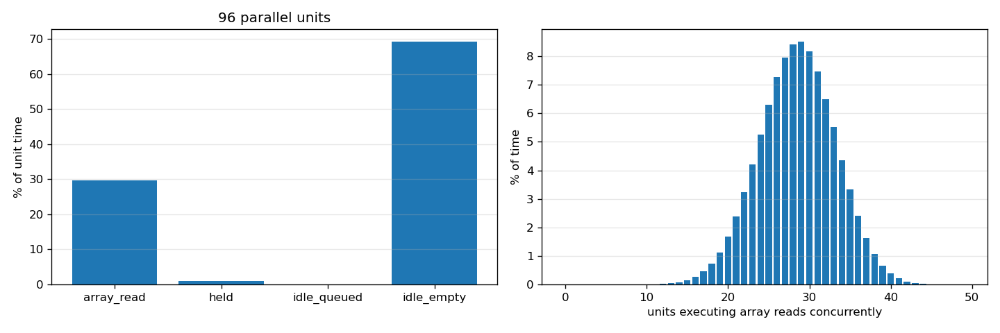
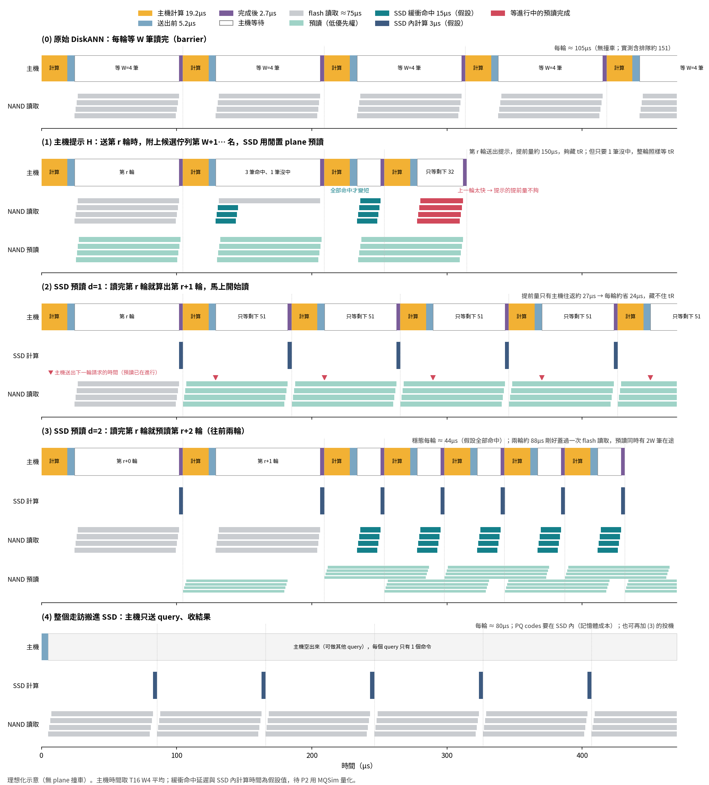
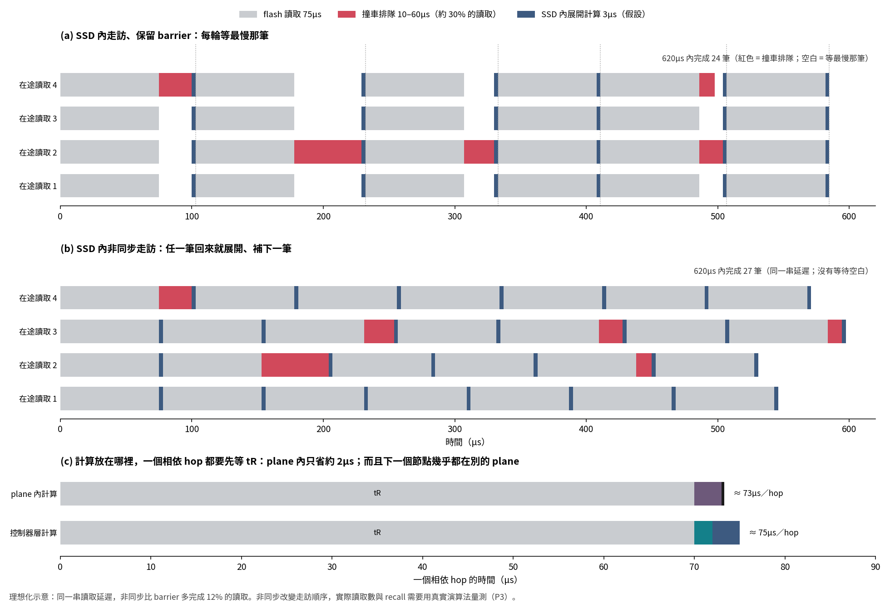
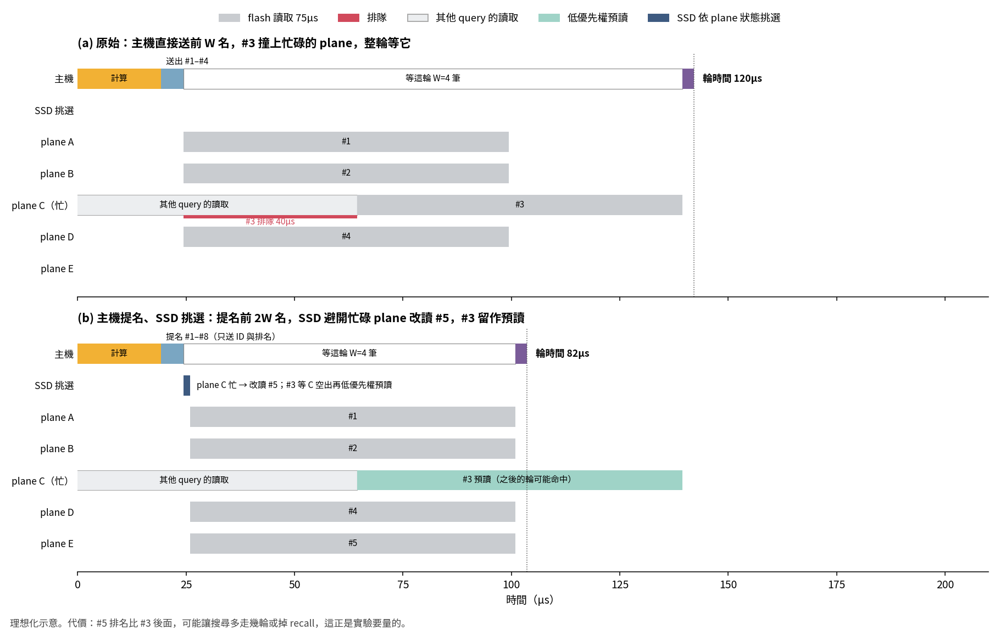

# DiskANN × SSD 內部時間利用研究紀錄

校準過程與模型細節見 [mqsim_calibration.md](mqsim_calibration.md)（已大致完成，之後只有再校準時才更新）。本檔記錄 2026-11-15 起的研究實驗。

## 研究目標

在 SSD 內放置硬體計算單元，加速或提升 DiskANN 的效能。第一步：**固定原始 DiskANN 的搜尋流程**（不改演算法、不改主機送出方式），觀察 SSD 內部有哪些時間或資源沒有被用到，可以拿來放計算。

## 圖表速覽

看紀錄時先看這幾張圖，細節在各節：
- [pipeline 示意](figures/pipeline_schematic.png)：一輪 W 筆讀取裡只要一筆撞上忙碌的 plane，整輪就被拖長（低負載的主要浪費）。
- [模擬實際截取](figures/pipeline_real_T16W4_w0_r42-45.png)：T16 W4 worker 0，撞車的輪 133–152µs，沒撞車的 85µs；channel 大多閒置。
- [平行單位時間分解 T16 W4](figures/slack_T16W4.png)：plane 約 70% 完全空閒。
- [候選架構 pipeline](figures/architecture_pipelines.png)：原始、主機提示、SSD 預讀 d=1/d=2、整個搬進 SSD 的時間線比較（理想化）。
- [barrier vs 非同步](figures/barrier_vs_async.png)：SSD 內非同步走訪不需要 plane 內計算；計算位置只影響每 hop 約 2µs，tR 才是相依鏈的下限。
- [beam width 取捨](figures/beamwidth_tradeoff.png)：W 越大 hop 越少、延遲下限越低，但讀取數增加、吞吐上限下降；（外插部分已被 P4 實測推翻）
- [P1 可預測性 SIFT100M W4](figures/prediction_sift100m_W4.png)：下一輪讀取＝主機已知的舊候選（56%）＋本輪新鄰居（44%）；兩邊合作才能 100%；SSD 沒有 PQ 幾乎無法預測。
- [P4 策略掃描 SIFT100M](figures/policy_sweep_sift100m.png)：hop 在約 8.5 到底；一單位一筆只在 W≥64 有作用；sector 展開在預設擺放下收益小。
- [主機提名、SSD 挑選](figures/nominate_choose.png)：主機提名前 2W 名，SSD 避開忙碌 plane 改讀，其餘低優先權預讀（設計示意，N 系列實驗待做）。
- [N1 提名／挑選功能代價](figures/nominate_sweep_sift100m.png)：p＝0.3、提名 2W 時，有忙碌讀取的輪 73%→11%（W4），hop 只多 1.7%，recall 不降；預讀命中約一半讀取。

## 方法

- **固定主機行為**：在伺服器（T500）上執行原始 `search_disk_index`，同時記錄 block 層請求（trace-cmd）與 DiskANN 每一輪讀取的 sector 和時間戳記（`diskann_block_trace.sh`）。
- **閉迴路重播**：在校準後的 MQSim（`ssdconfig_t500_calibrated.xml`）中，每個 worker 等上一輪讀取在模擬 SSD 中全部完成，再加上實測的主機時間，才送出下一輪（`IO_Flow_Closed_Loop_Replay`）。主機時間全部取自真機，只有 SSD 時間由模擬決定。
- **已知的模型可信度**（細節見校準紀錄）：
  - T16／W4 閉迴路重播：QPS 與真機差 −0.36%，每輪平均時間差 +0.09%。
  - 尾端偏輕：每輪 p99 約真機的 0.57 倍。量化後，尾端最多影響 QPS 約 4%，所以 **QPS 差異小於約 5% 時不下結論**。
  - 每個 plane 獨立讀取是用「每 plane 一個虛擬 LUN」近似的；tR 固定 70µs（真實 TLC 的三種 page 讀取時間不同）；主機時間固定。

## 「可利用的時間」要量什麼（初步定義，待討論）

| 類別 | 意思 | 可能的計算單元用途 |
|---|---|---|
| NAND plane 閒置 | plane 沒有在讀取的時間；再分成「沒有工作」與「有工作卻在等 channel／排程」 | 在 plane／LUN 旁做計算（類似 NDSearch 的 LUN 層加速器） |
| channel 閒置 | 匯流排沒有在傳指令或資料的時間 | 在 channel 控制器旁做計算，或內部搬資料 |
| 資料停留時間 | 資料從 NAND 讀出、經 channel、到主機收到的這段時間 | 讀出後就地過濾或計算距離，減少傳回主機的量 |
| 主機計算間隔 | 每一輪讀完到下一輪送出之間，主機在做 PQ 計算、更新候選；這段時間該 worker 對 SSD 沒有請求 | 把這段計算搬進 SSD，省掉一次往返 |

## 資料清冊

原始資料在本機 `microbench/results/`（gitignore），伺服器上有原始副本：`/home/user/MQSim/microbench/results/`。

| 目錄 | 設定 | 狀態 |
|---|---|---|
| `diskann_trace_20261114T202209Z_T16_W4_L100` | T16 W4 | 已轉換、已閉迴路驗證（`closed_loop/run_t500_full_20261115_050240`） |
| `diskann_trace_20261115T121746Z_T8_W4_L100` | T8 W4 | 已轉換、已產生閉迴路排程 |
| `diskann_trace_20261115T121805Z_T32_W8_L100` | T32 W8 | 已轉換、已產生閉迴路排程 |
| `diskann_trace_20261115T121821Z_T48_W8_L100` | T48 W8 | 已轉換、已產生閉迴路排程 |
| `diskann_trace_20261115T121838Z_T32_W16_L100` | T32 W16 | 已轉換、已產生閉迴路排程 |
| `diskann_trace_20261115T121856Z_T48_W16_L100` | T48 W16 | 已重拉、已轉換、已產生閉迴路排程 |

共同設定：SIFT100M uint8 disk index（R64 L100，40.96GB），10,000 query，L100、K10、不快取節點。

## 2026-11-15 負載掃描（真機）

所有 trace：trace-cmd 無遺失事件，index 檔分布前後一致；block 請求與 DiskANN `trace_access.csv` 的 sector 次數逐一相同；閉迴路排程把全部 block 請求對應到各輪（未對應 0 筆）。

| 設定 | DiskANN QPS | 每 query IO | 每 query hops | block IOPS | 平均在途 | 延遲 平均 / p50 / p90 / p99 / p99.9 (µs) | 每輪 read 平均 / p99 (µs) |
|---|---:|---:|---:|---:|---:|---|---|
| T8 W4 | 2,035 | 118.4 | 30.9 | 240,776 | 21.1 | 87.7 / 80.9 / 106.4 / 192.0 / 474.0 | 109 / 256 |
| T16 W4 | 3,439 | 118.4 | 30.9 | 406,895 | 40.2 | 98.9 / 82.9 / 131.5 / 382.8 / 599.4 | 131 / 480 |
| T32 W8 | 4,770 | 134.7 | 18.6 | 642,573 | 125.2 | 194.9 / 131.7 / 378.2 / 957.1 / 1,819.5 | 318 / 1,288 |
| T48 W8 | 4,936 | 134.7 | 18.6 | 664,937 | 194.4 | 292.4 / 196.7 / 599.1 / 1,473.4 / 2,683.4 | 478 / 1,900 |
| T32 W16 | 3,636 | 168.7 | 12.7 | 613,471 | 237.8 | 387.6 / 284.7 / 803.5 / 1,557.1 / 3,453.0 | 619 / 2,019 |
| T48 W16 | 4,032 | 168.7 | 12.7 | 680,293 | 395.9 | 582.0 / 510.9 / 1,011.6 / 2,072.4 / 4,820.2 | 853 / 2,632 |

觀察：
1. **DiskANN 下 SSD 約在 61–68 萬 IOPS 就飽和**，平均在途 125–396 筆、延遲大幅上升；同樣的在途數下，均勻隨機讀取可以到 86 萬（QD128）至 103 萬（QD256）。所以 DiskANN 的讀取模式只用到 T500 均勻隨機上限的約 62%。
2. **beamwidth 加大不一定更快**：W16 每個 query 多讀 25%（168.7 vs 134.7 次 IO），hops 變少，但 QPS 反而比 W8 低（T32：3,636 vs 4,770）。
3. **存取位置集中**：medoid 所在的 sector 每個 query 都讀一次（約 10,000 次）；前 100 個熱點 sector 占讀取 4.7%（W4）、7.4%（W8）、11.1%（W16）；同一 sector 在前一次讀取還沒完成時又被讀的比例 0.4%（T16W4）→ 2.1%（T48W8）→ 3.9%（T32W16）。
4. 每輪送出前的主機時間隨 W 增加：W4 約 4.5–5.2µs、W8 約 11µs、W16 約 19µs（送出更多讀取的成本）。

待驗證的假設：約 65 萬的飽和點來自 DiskANN 位址流的結構（熱點集中造成同 plane 撞車、每輪突發送出），不是主機 CPU（在途數很高，表示請求已經在 SSD 裡排隊）。下一步用閉迴路重播檢查：模型如果也在約 65 萬飽和，就表示位址流本身能解釋；如果模型接近 100 萬，代表真機還有模型沒有的限制。

T48 W16 補充：trace 期間另有 2,444 筆寫入（非 DiskANN，可能是系統日誌等背景寫入；只保留 index 範圍內的讀取）；閉迴路排程有 10 次 sector 讀取找不到時間窗內的 block 請求（占 1,687,371 的 0.0006%），其餘全部對應。在途 396 筆時 IOPS 只比 T48 W8 多 2%（680k vs 665k），延遲平均 582µs，已明顯是排隊區。

## 2026-11-15 閉迴路重播：6 組負載的獨立驗證

全部 6 組（T16 W4 為先前的 `run_t500_full_20261115_050240`，其餘為 `closed_loop/run_ssdconfig_t500_calibrated`）：HOST_EXIT generated＝completed、waiting＝0；FTL_EXIT gc_executions＝0、read_entries_created_online＝0。除 T16 W4 外，這些 trace 都沒有參與校準。

| 設定 | QPS 真機 | QPS 模型 | 差異 | 每輪 平均 真/模 (µs) | 每輪 p50 真/模 | 每輪 p99 真/模 | 單筆 p50 真/模 | 單筆 p99 真/模 |
|---|---:|---:|---:|---|---|---|---|---|
| T8 W4 | 2,035 | 2,035 | 0.0% | 109 / 109 | 97 / 89 | 256 / 216 | 81 / 74 | 192 / 172 |
| T16 W4 | 3,439 | 3,426 | −0.4% | 131 / 132 | 116 / 127 | 480 / 276 | 83 / 75 | 383 / 217 |
| T32 W8 | 4,770 | 5,244 | +9.9% | 318 / 282 | 245 / 241 | 1,288 / 953 | 132 / 92 | 957 / 528 |
| T48 W8 | 4,936 | 5,498 | +11.4% | 478 / 419 | 371 / 264 | 1,900 / 2,117 | 197 / 99 | 1,473 / 1,387 |
| T32 W16 | 3,636 | 3,858 | +6.1% | 619 / 572 | 510 / 292 | 2,019 / 2,432 | 285 / 90 | 1,557 / 1,785 |
| T48 W16 | 4,033 | 3,854 | −4.4% | 853 / 880 | 763 / 293 | 2,632 / 4,086 | 511 / 90 | 2,072 / 3,370 |

熱點 sector（前 100 個）與其他 sector 的單筆延遲：

| 設定 | 真機 熱點 p50 / p99 | 真機 其他 p50 / p99 | 模型 熱點 p50 / p99 | 模型 其他 p50 / p99 | >1ms 請求中熱點的比例 真/模 |
|---|---|---|---|---|---|
| T32 W8 | 147 / 850 | 131 / 969 | 125 / 920 | 90 / 447 | 4.4% / 43.0% |
| T48 W8 | 237 / 1,252 | 194 / 1,494 | 136 / 2,100 | 97 / 913 | 6.8% / 46.2% |
| T48 W16 | 546 / 1,799 | 507 / 2,120 | 119 / 3,899 | 89 / 2,736 | 12.3% / 53.7% |

解讀：
1. **低負載通過獨立驗證**：T8 W4 QPS 0.0%、每輪平均完全相同；T16 W4 −0.4%。
2. **模型也在 DiskANN 位址流下提早飽和**：高負載時模型 IOPS 65–74 萬（均勻隨機可到約 106 萬），與真機 61–68 萬同量級，支持「DiskANN 位址流本身會把可用吞吐壓到約六到七成」。
3. **但飽和的機制不同**：
   - 模型：慢只發生在熱點所在的 plane（熱點請求 p99 很高，其他請求 p50 仍約 90µs，>1ms 的請求有 43–54% 是熱點）——純粹的 plane 局部撞車。
   - 真機：熱點與非熱點一樣慢（p50 差不到 20%，>1ms 請求中熱點比例約等於熱點流量占比），單筆 p50 隨負載一路升到 511µs——所有請求一起排隊，像是有共用的瓶頸或隊頭阻塞。
   - 結果高負載 QPS 誤差 +10%、+11%、+6%、−4%，超過約定的 5% 解析度；單筆延遲分布形狀不同。高負載的「SSD 內部空閒時間」分析在釐清前不能直接用模型下結論。
4. 候選解釋（未驗證）：
   - 真機控制器有限的同時處理命令數（模型的 `Queue_Fetch_Size`＝512）：但均勻讀在 QD256 仍可到約 103 萬，表示這個上限至少要約 256；T32 W8 在途只有 125 就已全面變慢，單靠這個解釋不了。
   - 韌體佇列依序派送造成的隊頭阻塞：隊頭請求卡在忙碌的熱點 plane，後面要去空閒 plane 的請求也要等。MQSim 的 TSU 是亂序挑選，不會有這種阻塞。
   - 主機端：高 thread 數時 CPU 很忙，block 層量到的完成時間可能包含主機延遲（送出前主機時間 W8 約 11µs、W16 約 19µs 也隨負載增加）。T32（48 個硬體執行緒用了 32 個）也出現同樣現象，所以 CPU 滿載不太像唯一原因。

## 2026-11-15 實驗 B（已準備，待執行）：用 fio 重播 DiskANN 位址

目的：分辨高負載下「所有請求一起變慢」來自 SSD 內部還是主機端。fio 幾乎沒有主機計算，若用同樣位址也出現此現象，原因在 SSD；否則是 DiskANN 高 thread 數時的主機端效應。

工具：`microbench/build_fio_iolog.py`（由 `real_requests.csv` 產生 fio v2 iolog）、`microbench/fio_addr_replay.sh`（伺服器執行，trace-cmd 記錄 block 事件）。

設計：來源為 T48 W8 的 1,346,966 筆讀取；4 個 fio job 輪流分配請求；總 QD 128／192／256／400（對應 DiskANN 各組的平均在途 125–396）；三種位址模式：
- diskann：原始送出順序
- shuffled：相同請求、隨機順序（保留熱點、去掉時間結構）
- uniform：相同筆數、index 檔內均勻隨機 4KB（無熱點，對照組）

判讀：比較各模式的 IOPS，以及 block 層延遲在「熱點 sector vs 其他」的差別。

## 2026-11-15 實驗 B 結果：fio 重播 DiskANN 位址（fio_addr_replay_20261115T124551Z）

12 次執行全部完成，每次 1,346,966 筆讀取，index 檔分布前後一致（fio-3.36，4 jobs）。分析：`microbench/analyze_fio_addr_replay.py`（block 層 issue→complete，去掉頭尾各 5% 時間；熱點＝來源 trace 前 100 個 sector，占讀取 7.4%）。

| 執行 | IOPS | 熱點 p50 / p99 (µs) | 其他 p50 / p99 (µs) | >1ms 中熱點比例 |
|---|---:|---|---|---:|
| diskann QD128 | 736,065 | 134 / 604 | 122 / 599 | 6.3% |
| diskann QD192 | 723,277 | 205 / 1,033 | 175 / 1,017 | 8.2% |
| diskann QD256 | 767,426 | 279 / 1,160 | 235 / 1,042 | 11.0% |
| diskann QD400 | 775,932 | 464 / 1,427 | 401 / 1,351 | 10.6% |
| shuffled QD128 | 728,853 | 133 / 586 | 122 / 599 | 5.1% |
| shuffled QD192 | 762,305 | 202 / 895 | 173 / 855 | 7.7% |
| shuffled QD256 | 780,174 | 283 / 1,098 | 239 / 1,030 | 10.6% |
| shuffled QD400 | 759,719 | 463 / 1,510 | 405 / 1,410 | 10.6% |
| uniform QD128 | 855,440 | – | 106 / 677 | – |
| uniform QD192 | 885,625 | – | 142 / 972 | – |
| uniform QD256 | 944,498 | – | 181 / 994 | – |
| uniform QD400 | 940,406 | – | 302 / 1,205 | – |

（uniform 列的「熱點」只有零星命中，不具意義，略去。）

結論：
1. **「所有請求一起變慢」是 SSD 本身的行為**：幾乎沒有主機計算的 fio，用同樣位址也出現熱點與非熱點延遲相近（p50 差 10–16%、p99 幾乎相同），>1ms 的請求中熱點比例約等於熱點流量占比。所以不是 DiskANN 高 thread 數的主機效應。
2. **熱點分布本身就壓低吞吐**：同一套 fio 下，DiskANN 位址約 72–78 萬 IOPS，均勻位址 86–94 萬；DiskANN 位址只有均勻的約 80–86%。
3. **時間順序不重要**：shuffled 與 diskann 幾乎相同，影響來自「哪些位址」，不是「什麼順序」。
4. 與真機 DiskANN 對照：fio QD128 的 p50 132µs 與 T32 W8（平均在途 125）的 132µs 相同；QD192 p50 191µs 與 T48 W8（在途 194）的 197µs 接近。DiskANN 本身 IOPS 比 fio 同 QD 再低約 10–13%（每輪成批送出、主機時間），但延遲型態一致。
5. 與模型對照：模型在 DiskANN 位址下的 IOPS（閉迴路 70.6–74.1 萬）其實接近真機 fio（72–78 萬），但模型的壅塞只留在熱點 plane（非熱點 p50 約 90µs），真機則擴散到所有請求。模型缺少一個「熱點壅塞會擋到其他請求」的共用機制。

研究上的意義：在 DiskANN 的熱點存取下，T500 不只是熱點 plane 忙，而是整顆 SSD 的請求都被拖慢；同時非熱點 plane 很可能因為被擋住而閒置。這段「被擋住的時間」本身就是一種可利用的時間（例如在 SSD 內快取或複製熱點節點、或在被擋住時做計算），但要先讓模型能重現這個機制，才能量化。

## 2026-11-15 下一步（已準備，待執行）：讓模型重現「共用壅塞」

假設：真機控制器同時持有的命令數有限。熱點 plane 積壓的命令占住這些名額時，其他請求只能在 submission queue 裡等，壅塞就擴散到所有請求。MQSim 已有對應參數 `Queue_Fetch_Size`（每個 stream 同時在裝置內的命令上限，校準值 512，等於不設限）。

工具：`microbench/mqsim_fio_replay.py`（prepare／run／compare）。用 fio 實驗的 block 層請求，在 MQSim 中以相同 QD、相同位址重播（QD 個虛擬 worker、每輪 1 筆，round-robin 分配；輪間隔用 fio 實測的每筆主機周轉時間：diskann QD128／192／256／400 為 9.2／15.5／18.1／21.4µs，uniform QD128／256／400 為 9.8／21.7／32.1µs）。

設定：`ssdconfig_t500_calibrated.xml`（512）與 `microbench/configs/ssdconfig_t500_fetch{256,192,128}.xml`，其餘參數相同；重播 diskann QD128／192／256／400 與 uniform QD128／256／400，共 28 次。

判讀：好的設定要同時做到 (1) diskann 位址下熱點與非熱點延遲相近、IOPS 約 72–78 萬；(2) uniform 位址仍到 86–94 萬（不能破壞原校準）。若 `Queue_Fetch_Size` 做不到，再考慮韌體依序派送（隊頭阻塞）的機制。

## 2026-11-15 熱點是什麼：medoid 附近的前幾輪

使用者提問：熱點是不是 medoid？DiskANN 不是可以把熱點快取在主機 DRAM？

T48 W8 每輪的讀取集中程度（`trace_access.csv`）：

| 輪 | 讀取次數 | 不同 sector 數 | 最熱 sector 次數 |
|---|---:|---:|---:|
| 0 | 10,000 | 1（medoid 所在 sector） | 10,000 |
| 1 | 80,000 | 64（medoid 的鄰居） | 3,612 |
| 2 | 80,000 | 3,736 | 595 |
| 3 | 80,000 | 43,753 | 83 |

前 N 個熱點 sector 占全部讀取的比例：

| 設定 | 前 1 | 前 10 | 前 100 | 前 1,000 | 前 10,000 | 前 100,000 |
|---|---:|---:|---:|---:|---:|---:|
| T16 W4 | 0.8% | 2.1% | 4.7% | 6.9% | 10.0% | 23.1% |
| T48 W8 | 0.7% | 2.7% | 7.4% | 11.0% | 15.4% | 28.5% |
| T48 W16 | 0.6% | 3.4% | 11.0% | 16.5% | 23.2% | 35.5% |

所以熱點是「每個 query 都從 medoid 出發」造成的：第 0 輪全部讀同一個 sector，第 1 輪只讀 64 個 sector，第 2 輪也只有約 3,700 個。這正是 DiskANN `num_nodes_to_cache`（從 medoid 做 BFS 快取節點到主機 DRAM）會消掉的部分。我們的 trace 刻意設成 0，讓所有讀取都打到 SSD；實際部署通常會開快取。每個節點 388 bytes、每 sector 10 個節點，快取 10,000 個節點約 4MB、100,000 個約 39MB。

影響：前面觀察到的「熱點造成全面壅塞、吞吐只有均勻的 80–86%」，在開了快取的實際設定下可能大幅減弱。研究應以開快取的 DiskANN 為主要對象；`num_nodes_to_cache=0` 的結果保留，作為「SSD 遇到熱點時的行為」。Queue_Fetch_Size 的 28 次重播先暫緩，等開快取的 trace 看殘餘熱點還有多少再決定。

## 背景：先前在 GM7 上的資料擺放研究（DiskANN_cpp `vucann` 分支）

使用者先前（2026-10 至 11 月初，筆電 Predator GM7）做過：neighbor list 與 full vector 分開存放、PQ codes 放主機 DRAM、neighbor 做 greedy BNF 重排；比較 A（vanilla）／B（合併＋BNF）／C（分開）／D100／D40（分開＋BNF＋精算全部或前 40%）／E_host（只量主機 traversal，代表「SSD 算 exact distance」方案）；以及 traverse-only、Host worker 兩種主機架構。設定為單一 query thread、無 node cache、SIFT100M R64、10,000 query（`experiments/abcd`、`experiments/split_async`、`experiments/layout_ablation`；結果在 DiskANN_cpp `results/abcd_*`）。

當時未解的問題：拿掉 vector 讀取後 neighbor 延遲下降得比預期多；E 的 neighbor 延遲為何特別低（L120 W16 p95 163µs vs D100 1,593µs）；Host worker 為何沒有比 baseline 好。

### 檢查：GM7 雙狀態干擾（2026-11-15）

依執行時間排列 `results/abcd_block` 的 36 個 job（block 層平均／p95）：多數 job 的 p95 在 1,350–2,340µs，少數只有 163–446µs（B L60 W8、E L120 W8、D40 L60 W16、E L120 W16），快的 job 分散在不同 case，與 case 無關。

每 2 秒平均延遲（µs）顯示**同一個 job 內就會在兩種狀態間切換**：
- A L60 W8：前 26 秒約 120–133，之後跳到 591–714。
- B L60 W8：開頭 403–903，之後穩定在 116–128。
- D100 L120 W16：在約 125 與 700–1,050 之間來回切換多次。
- E_host L120 W16：整段都在 99–122（剛好全程處於快狀態）。
- E_host L60 W16：前 44 秒約 106–115，之後跳到 606–1,077。

快狀態約 100–150µs、慢狀態約 600–1,050µs，與 2026-11-14 state probe 測到的 GM7 快／慢狀態一致（見校準紀錄）。

結論：GM7 上 A–E 的延遲差異主要受「該 job 執行時 SSD 剛好處於哪個狀態」支配。「E 特別快」至少有一部分（L120 W16 全程快狀態）是狀態造成的假象。IO 次數、主機 CPU 時間、io_submit 時間等不依賴 SSD 狀態的計數仍可參考；延遲與等待時間需要在 T500 上重測。

## 2026-11-15 Part A（已準備，待執行）：SSD 內部時間分解

MQSim 新增 `MQSIM_TRANSACTION_LOG=<path>`（`NVM_PHY_ONFI_NVDDR2`）：每筆 flash 讀取完成資料傳出後記一行：TSU 收到時間、指令開始傳送、array read 開始／結束、資料傳出開始／結束、channel／chip／die／plane／block／page、來源。只記錄時間戳記，不改任何時序，所以同一份輸入的結果應與先前逐位相同（可當回歸檢查）。

分析 `microbench/analyze_ssd_slack.py <run_dir>`（頭尾各去掉 5% 時間）：
- 每個平行單位（校準設定下＝一個 plane，模型中是虛擬 LUN）的時間分成：array read（tR）、held（指令傳送、資料等 channel、資料傳出，die 被占住但沒在讀 array）、idle_queued（die 空著但 TSU 裡有它的讀取在等）、idle_empty（die 空著也沒有工作）。
- 每條 channel：指令傳送、資料傳送、閒置。
- 整顆 SSD：完全沒有讀取在處理的時間比例；同時在做 array read 的單位數分布。
- 檢查：同一單位占用區間、同一 channel 匯流排區間不得重疊；列出 array read、資料傳出、指令的實際時間範圍供對照設定值。
- 已用手算的合成時間軸自我測試，各類時間與重疊偵測都正確。

`run_mqsim_closed_loop.sh` 預設開啟此紀錄，並在比較後自動產生 `slack.json`／`slack.png`。

## 2026-11-15 Part A 結果：低負載下 SSD 內部的時間分解

執行：`closed_loop/run_slack`（T8 W4、T16 W4，校準設定，`num_nodes_to_cache=0`）。
- 回歸：QPS 與總時間和先前執行逐位相同（T8 2,035.057690／4.913865611 s；T16 3,426.341181／2.918565161 s），加紀錄沒有改變模擬。
- 檢查：同一單位占用區間重疊 0、同一 channel 匯流排重疊 0；array read 全部 70,020ns（tR 70µs＋R/B 20ns）、指令 290ns、資料傳出 1,707ns（4KB），最大 6,827ns 為少數 16KB 交易。FTL_EXIT 全為 0。
- 共 1,183,263 筆 flash 讀取、96 個平行單位，分析窗為頭尾各去 5%。

### 1. 平行單位（plane）與 channel

| 指標 | T8 W4 | T16 W4 |
|---|---:|---:|
| array read（tR） | 17.6% | 29.7% |
| held（指令、等 channel、資料傳出） | 0.6% | 1.0% |
| idle_queued（有工作在排隊卻閒著） | 0.02% | 0.05% |
| **idle_empty（完全空閒）** | **81.8%** | **69.2%** |
| 單位 array read 比例 最低／平均／最高 | 16.3% / 17.6% / 31.6% | 27.5% / 29.7% / 53.2% |
| 同時在做 array read 的單位數 平均／p50／p90／最大（共 96） | 16.9 / 17 / 22 / 32 | 28.5 / 29 / 34 / 49 |
| channel 資料傳送／指令傳送（每條） | 約 10.3% / 1.7% | 約 17.4% / 2.9% |
| 整顆 SSD 完全沒有讀取在處理 | ≈0% | 0% |
| 每筆讀取在 TSU 排隊（等該單位空出來）平均 | 8.3µs | 16.7µs |
| 資料讀出後等 channel 平均／p99 | 0.40 / 3.3µs | 0.42 / 3.7µs |

*圖：T16 W4。左：96 個平行單位的時間分解，約 70% 完全空閒。右：同時在做 array read 的單位數，集中在 20–40 個。T8 W4 見 [slack_T8W4.png](figures/slack_T8W4.png)。*

### 2. 每一輪的時間組成（模擬；平均每輪 3.83 筆讀取）

| 組成 | T8 W4 | T16 W4 |
|---|---:|---:|
| 輪時間（read_begin→read_end） | 109.1µs | 131.5µs |
| 送出前主機時間 | 4.5 | 5.2 |
| 最慢那筆讀取 | 101.3 | 122.8 |
| 　└ 其中裝置下限（tR＋指令＋傳輸＋介面，約） | ~73 | ~73 |
| 　└ 其中排隊（等 plane 空出來） | ~28 | ~50 |
| 　（同輪平均讀取延遲 → 最慢比平均多） | 82.6 → +18.7 | 91.5 → +31.3 |
| 同輪送出間隔 | 0.8 | 0.8 |
| 完成後到 DiskANN 收到 | 2.5 | 2.7 |
| 輪與輪之間的主機計算（實測，平均／p50／p90） | 17.9 / 15.0 / 21.4 | 19.2 / 16.3 / 23.1 |

排隊的分布：最熱的 1 個單位只占總排隊時間 3–4%，前 5 個約 11%；**約 71% 的排隊發生在讀取量排名 20 以後的一般單位**。所以排隊主要是隨機撞車（同一時間約 17–28 筆讀取分散在 96 個單位上，新的讀取有相當機率落到正在讀的單位，要等最多一個 tR），不是熱點造成的。

### 解讀（與四類可利用時間對照）

1. **plane 大量空閒**：低負載下 69–82% 的 plane 時間完全沒有工作；平均只有 17–28 個單位同時在讀。
2. **channel 大量空閒**：每條 channel 約 80–88% 的時間閒置。
3. **資料在 NAND／channel 端的停留很短**：資料讀出後平均只等 0.4µs 就傳走；「資料停留」主要發生在主機端（PCIe、驅動、DiskANN 處理），這部分不在 SSD 模型內。
4. **主機時間**：每輪約 7–8µs 的送出／完成處理，加上輪與輪之間 18–19µs 的主機計算；以 T16 為例，每輪約 150µs 中約 27µs（18%）在主機端。
5. **關鍵路徑上真正的浪費是「最慢那筆讀取的排隊」**：雖然大部分 plane 閒著，每輪最慢的讀取仍平均多等 28–50µs（占輪時間 26–38%），因為 DiskANN 每輪要等 W 筆全部回來，只要其中一筆撞到正在讀的 plane 就整輪變慢。

對 SSD 內計算的初步含意（待驗證）：
- 空閒的 plane 與 channel 容量很大，可以吸收額外工作（例如預讀下一輪候選、在 SSD 內讀 full vector 做 exact distance），只要不和關鍵路徑上的 neighbor 讀取撞在同一個 plane。
- 若把「挑下一輪候選、送出下一輪讀取」放進 SSD，每輪可省去主機端約 27µs（送出、完成、計算）；但 SSD 內仍需同等的計算時間，淨收益取決於 SSD 內計算單元的速度。
- 降低撞車（例如把常用節點複製到多個 plane、讀取時挑空閒的副本）可以直接縮短關鍵路徑。

限制：只在已驗證的低負載；`num_nodes_to_cache=0`（熱點未快取，不過排隊主要來自一般單位）；每 plane 獨立是虛擬 LUN 近似；tR 固定 70µs（真實 TLC 三種 page 讀取時間不同，會增加每輪最慢讀取的變異）；模型尾端偏輕，真實的「最慢那筆」可能更慢。

## 2026-11-16 目前判斷：傳統 DiskANN 下 SSD 內部的瓶頸在哪

使用者提問：傳統 DiskANN workload 下，SSD 內部的瓶頸在哪？為什麼會壅塞？以下整理到目前為止的證據，不是新實驗。

**低負載（T8–T16 W4，模型已驗證）：沒有任何資源飽和，瓶頸是關鍵路徑上的延遲。**
- plane array read 只占 18–30%，channel 資料傳送 10–17%，idle_queued 約 0。
- 每輪的週期（T16 W4，約 151µs）：tR 約 70µs（46%）＋排隊約 50µs（33%）＋主機約 27µs（送出前 5、完成後 3、輪間計算 19，共 18%）＋指令/傳輸/介面約 3µs。
- 會「壅塞」，是因為每輪要等 W 筆讀取全部回來，加上 plane 隨機撞車，不是頻寬不夠。同時約 28 筆讀取分散在 96 個單位上，新讀取落到正在讀的單位的機率約 30%；W=4 時至少一筆撞到的機率約 1−0.7⁴≈76%，所以大多數輪都要多等一段（最多一個 tR）。71% 的排隊發生在一般單位，與熱點無關。

**高負載（T32 以上，W8/W16）：真的飽和，分兩層。**
1. 位址流的熱點（medoid 附近前幾輪，`num_nodes_to_cache=0`）把少數 plane 塞滿。模型能重現這一層的吞吐量級（65–74 萬 IOPS vs 均勻約 106 萬）。
2. 真機的壅塞會擴散到所有請求：熱點與非熱點 p50 相近，fio 也一樣，所以是 SSD 本身的行為。模型沒有這一層，候選是韌體依序派送造成的隊頭阻塞、控制器內有限的命令名額，都還沒驗證。
- 粗算 NAND 上限：96 單位 ÷ 70µs ≈ 137 萬 IOPS；channel 約 2µs／4KB，4 條約 200 萬。真機均勻讀約 94 萬，所以高負載的上限不在 NAND/channel 本身，而在排程與共用的控制器資源。

**對研究的含意**：NAND 與 channel 有大量閒置，但瓶頸是「每輪最慢那筆」與 tR 本身，以及高負載時的共用排程。值得做的方向是縮短關鍵路徑：減少輪數或主機往返、避免撞車（熱點複製、感知撞車的擺放/派送），或在 SSD 內完成部分走訪。單純用閒置頻寬多讀資料，不會直接變快。

待確認：tR 變異（TLC 三種 page 讀取時間）會讓「最慢那筆」更慢；開 `num_nodes_to_cache` 後，高負載的熱點層還剩多少；真機共用壅塞的機制。

### Pipeline 示意圖（2026-11-16）
產生方式：`microbench/plot_pipeline_diagram.py`（`schematic` 或 `real <trace> <run> --worker W --rounds A B`）。

*圖：理想化示意，用 T16 W4 的平均值畫。第 0 輪 P3 撞上其他 worker 正在讀的 plane，排隊約 40µs，其他三筆早就回來了，整輪還是被最慢那筆拖長。第 1 輪沒撞車。channel 只有細細的傳輸。*

*圖：從 `run_slack` 的交易紀錄實際截取 worker 0 第 42–45 輪。第 42、43 輪各有一筆撞上其他 worker（淺灰）正在讀的 plane，在 TSU 排隊約 50µs 與 72µs（紅），整輪拉長到 133µs、152µs。第 44、45 輪沒撞車，85µs。截取視窗內每條 channel 使用率 16–27%。*

## 2026-11-16 討論：如何打破每輪的 batch barrier、還要調查什麼（計畫，未執行）

**barrier 的代價（T16 W4，週期約 151µs）**：最慢那筆比同輪平均多約 31µs，排隊約 50µs。假設完全不撞車、也不用等齊，每輪大約是 tR 等裝置下限約 73µs，加上主機約 27µs，約 100µs，低負載 QPS 上限約 1.5 倍。

打破 barrier 的方向：
1. **主機端非同步**（不改 SSD）：任一筆讀取回來就展開、送下一筆（例如 PipeANN 的作法）。這會改動 DiskANN 本身，在本研究中當作比較基準。
2. **SSD 內減少撞車**（不改主機）：熱點/鄰近節點複製到多個 plane，由 SSD 挑空閒的 plane 讀；或把常用節點放在讀取較快的 page 類型。目標是縮短最慢那筆。
3. **SSD 內預讀**（in-SSD 計算）：node page 本身就含鄰居清單。SSD 若握有 query 與 PQ 表，可以在本輪讀取還在進行時，挑出下一輪可能的鄰居，用約 70% 空閒的 plane 預先讀進 SSD DRAM。下一輪命中時省掉 tR。關鍵是預測命中率。
4. **SSD 內完成走訪**（NDSearch 類）：整個 best-first 迴圈在 SSD 內進行，沒有主機往返（每輪約 27µs），SSD 也可以逐筆非同步展開，每個 query 只需要一個 NVMe 命令。

**高負載延遲全面上升的推測（未驗證）**：
- 均勻讀本身就有全域上限：QD128 到 400，IOPS 約 86 萬到 94 萬幾乎不動，p50 卻從 106µs 漲到 302µs。到了上限之後，延遲依 Little's law 全面上升。
- plane 撞車的理論值（96 單位、tR 73µs，在途 N 筆時 96·(1−e^(−N/96))/73µs）：QD128 約 97 萬，與真機接近；QD400 約 129 萬，但真機只有 94 萬。所以高 QD 時的上限不在 NAND。
- DiskANN 位址下上限更低（72–78 萬）。推測熱點 plane 積壓的命令占住這個全域資源（控制器內的命令名額，或依序派送），所以非熱點也一起變慢。MQSim 的 TSU 是亂序挑選，所以模型重現不出來。

待調查（依建議順序）：
- A. **模型：barrier 的上限**。在閉迴路重播加入「滑動視窗」模式：同樣的位址序列，每個 worker 維持 W 筆在途，一筆完成就送下一筆。量化純粹由 SSD 端看到的 barrier 代價（成本低，不需新資料）。
- B. **真機：高負載全域上限是什麼**。均勻 4KB 讀約 94 萬 IOPS 就飽和，低於 plane 撞車理論值（QD400 時約 129 萬）。用 fio 掃描：
  - jobs 4/8/16：分辨是主機送出端還是 SSD 的上限；
  - block size 4K/8K/16K：IOPS 固定代表上限在每個命令（控制器處理），頻寬固定代表上限在資料路徑。
  - 若是每個命令的上限，方向 4（每個 query 一個命令）的論點就很強。
- C. **真機：為什麼非熱點也一起變慢**。fio 干擾實驗：一個 job 重複讀 DiskANN 前 100 個熱點 sector（高 QD），另一個 job 均勻隨機讀（低 QD），看均勻 job 的延遲是否隨熱點 job 的 QD 上升。再把兩個 job 綁到不同 CPU（不同 NVMe 硬體佇列）比較：若分開就隔離，代表是同一個 submission queue 的隊頭阻塞；若仍互相影響，代表是控制器內共用的名額或排程。
- D. 開 `num_nodes_to_cache` 重錄高負載 trace，看熱點還剩多少（決定 C 的現象在實際部署下是否重要）。
- E. 離線分析方向 3 的預測命中率：用 trace 的走訪節點加上 index 的鄰居清單與 PQ，算「第 r 輪讀到的節點中，PQ 最近的 k 個未拜訪鄰居」涵蓋第 r+1 輪讀取的比例。
- F. tR 變異（TLC 不同 page 類型）的敏感度。

## 2026-11-16 討論：既然 SSD 能探索，為什麼不全部搬進 SSD？主機的優勢在哪？

使用者的問題：SSD 若已經能預讀（等於有探索能力），為什麼不把整個搜尋都搬進 SSD？研究需要想清楚主機的優勢在哪。

**從時間組成看兩種作法的收益**（T16 W4，每 query 30.9 輪，每輪約 151µs，每 query 約 4.7ms）：
- 主機往返（送出前、完成後、輪間計算）約 27µs/輪，約 18%：只有「全部搬進 SSD」才省得到。
- tR 約 70µs（46%）與排隊約 50µs（33%）：「預讀」與「全部搬進 SSD」都要靠 SSD 內的投機讀取才能藏起來。
- 結論：主要收益在 SSD 內部的延遲，不在拿掉主機。全部搬進 SSD 相對於預讀，額外收益在低負載下最多約 18%。

**主機的優勢**：
1. **大記憶體**。
   - DiskANN 的 PQ codes 全部放在主機 DRAM，數 GB 等級（例：1 億點 × 32 bytes ≈ 3.2GB，實際大小待查）。
   - 熱點節點快取（`num_nodes_to_cache`）也在主機。
   - SSD DRAM 通常只夠放 FTL 映射表（約 1GB/TB），T500 的 DRAM 配置待確認。
   - 全部搬進 SSD 時，PQ codes 只能從 flash 讀，會多出讀取，或要額外加大 SSD DRAM。
2. **算力與彈性**。
   - 多核心、SIMD、可以隨時改演算法：過濾條件、不同距離、更新、重排序、混合查詢。
   - SSD 內的硬體在功耗（M.2 約數 W）與面積上受限，功能固定。
3. **跨裝置協調**：index 跨多顆 SSD 時，圖的邊會跨裝置，只有主機看得到全局。
4. **正確性的掌控**：預讀是純投機，主機仍決定走訪順序，recall 完全不變，對任何 DiskANN 變體都透明。

**SSD 的優勢**：
1. 存取延遲低：不用經過 PCIe 與驅動。
2. 看得到即時的 plane/channel 狀態：可以挑空閒的 plane，利用閒置頻寬而不干擾關鍵路徑。主機看不到這些。
3. 知道實體擺放：一個 16KB page 裡的其他節點可以順便利用。

**分工的假說**：主機保留需要大記憶體與彈性的部分（PQ codes、候選佇列、熱點快取、重排序、跨 SSD 協調）；SSD 負責需要內部可見度與低延遲的部分（投機預讀、依 plane 狀態派送、就地過濾或計算 exact distance）。

**全部搬進 SSD 何時會勝出**：高負載時若主機 CPU 或「每個命令」的控制器上限成為瓶頸（待調查 B），每個 query 一個命令就可能勝出。

**判定用的實驗**（擴充待調查 E）：比較三種預測器對下一輪讀取的命中率：
- (a) 主機提示：候選佇列中第 W+1…2W 名，SSD 不需要 PQ；
- (b) SSD 用 PQ：對剛讀到節點的鄰居排序；
- (c) SSD 不用 PQ：只靠鄰居清單的簡單規則。

(a) 已經夠好，就代表智慧可以留在主機、SSD 只需要低優先權預讀；(b) 明顯勝過 (a)，SSD 內計算才有價值。

## 2026-11-16 實驗計畫：SSD 內預讀可不可行、值不值得放計算單元

### 要回答的問題
- **Q1 預測**：下一輪要讀哪些節點，能預測多準？準確度取決於「誰握有什麼資訊」：主機的候選佇列，或 SSD 看到的鄰居清單加上 PQ。
- **Q2 時間**：預測準的話，能省多少輪時間？預讀用掉的閒置 plane 會不會反過來拖慢關鍵讀取？
- **Q3 基準**：不改 SSD，只靠主機非同步或主機端投機讀取，能做到多少？

### 關鍵限制：預測的「提前量」
預讀要省掉 tR，必須在主機送出下一輪前約 70µs 就開始讀。T16 W4 平均值：

| 預測者 | 什麼時候能預測第 r+1 輪 | 提前量 | 能否藏住 tR（70µs） |
|---|---|---|---|
| 主機提示：第 r 輪送出時附上候選佇列第 W+1… 名 | 第 r 輪開始 | 約 131.5（輪時間）＋19.2（輪間計算）≈ 150µs | 可以，但沒看到第 r 輪讀出的鄰居，可能不準 |
| SSD：第 r 輪某筆讀完、看到鄰居清單後 | 該筆完成時 | （輪結束 − 該筆完成）＋約 27µs ≈ 27–77µs | 大多藏不住，只省掉主機往返那一段 |
| SSD：往前多看一輪（預測第 r+2 輪） | 第 r 輪讀完 | ＋約 150µs | 可以，但更難預測 |

所以 SSD 內預讀的價值取決於「往前兩輪」能預測多準，不只是下一輪。實驗要量 d=1、2 兩種提前輪數。

*圖：候選架構的理想化 pipeline（無撞車；主機時間取 T16 W4 平均；緩衝命中 15µs、SSD 內計算 3µs 為假設值）。由 `plot_architecture_pipelines.py` 產生。*
- (0) 原始：每輪約 105µs，含撞車實測約 151µs。
- (1) 主機提示：提前量夠，但 **barrier 讓「部分命中」沒有用**，一輪 W 筆要全部命中才會變短；上一輪變快之後，下一輪提示的提前量也跟著縮短。
- (2) SSD 預讀 d=1：提前量只有主機往返約 27µs，每輪只省約 24µs，等同拿掉主機往返。
- (3) SSD 預讀 d=2：全部命中時每輪約 44µs，但預讀同時要有 2W 筆在途，也要往前兩輪都預測準。
- (4) 整個搬進 SSD：每輪約 80µs，主機空出來；PQ codes 要放在 SSD 內。

由此 P1 多加一個指標：**整輪全部命中的比例**（W 筆都被預讀到），因為 barrier 下只有整輪命中才會縮短輪時間。

### 實驗 P1：預測命中率（離線，優先）
- **DiskANN_cpp 加紀錄**（選項開啟才記，不改搜尋行為）：每個被展開的節點記（query, 輪, parent id, 鄰居 id, 鄰居 PQ 距離）。三條展開路徑都要記：快取、sector candidates、一般讀取。主機本來就會算這些 PQ 距離，不增加計算。
- **離線重建**：用紀錄重演 DiskANN 的候選佇列（容量 L、`closest_unexpanded`）。重建出的每輪 frontier 必須與 `trace_access.csv` 逐筆相同，這是正確性檢查。
- **比較的預測器**（每個都在「它當時能知道的資訊」下預測）：
  - **H 主機提示**：第 r 輪送出時，候選佇列中未展開的第 W+1…W+k 名。
  - **S-PQ**：SSD 用第 r 輪讀到節點的鄰居。SSD 看過這個 query 所有讀取，可以自己重建 visited。以 PQ 距離排序取前 k，需要鄰居的 PQ codes。
  - **S-full**：SSD 同時握有候選佇列與 PQ，等於在 SSD 內走訪，作為上限。
  - **S-noPQ**：不用 PQ。依 parent 與 query 的 exact distance（SSD 有 parent 的 full vector）排 parent，再取其鄰居；或依鄰居清單順序。
- **指標**：
  - 整輪全部命中的比例：W 筆都被預讀到；barrier 下只有這種情況才會縮短輪時間；
  - 涵蓋率：第 r+d 輪實際讀取中，被預讀到的比例；
  - 精準度：預讀中有用的比例；
  - 預讀筆數相對原讀取的倍數：對照閒置容量，T16 W4 約 69% 空閒；
  - 參數 k ∈ {W, 2W, 4W, 8W}、d ∈ {1, 2}。
- **設定**：SIFT100M R64 L100，W4 與 W8，1000 query，1 thread（預測與時序無關），`num_nodes_to_cache` 0 與 100k。
- **判讀**：
  - H 在 d=2 已接近 S-PQ：預測不需要 SSD 內計算，SSD 的價值在派送和優先權；
  - S-PQ 明顯勝過 H：SSD 內計算有理由；
  - S-PQ 需要每個鄰居的 PQ codes，放哪裡（SSD DRAM 或 node page 內）是設計成本，P1 之後評估。

### 實驗 P2：時間收益（MQSim，P1 之後）
閉迴路重播加入預讀：
- P1 產生每輪的預讀清單與發出時間（依各預測器的提前量）；
- 預讀以低優先權讀進 SSD 緩衝。主機讀取時：
  - 已在緩衝：只算 DRAM 命中延遲；
  - 正在讀：等它完成；
  - 都不是：正常讀。
- 量 QPS、每輪時間，以及非預讀請求被干擾的程度。需要確認 MQSim 的優先權佇列能否用在同一個 flow。

### 實驗 P3：主機端基準（MQSim）
滑動視窗重播（前面的待調查 A）：同樣位址，每個 worker 維持 W 筆在途。這是「不改 SSD、只改 DiskANN 成非同步」的上限。

### 平行進行：真機高負載上限（前面的待調查 B、C）
fio 均勻讀 jobs × block size 掃描，以及熱點/均勻讀的干擾實驗，與 P1–P3 無相依。

### 順序
1. P1 的 DiskANN 紀錄與離線分析（我實作，使用者在伺服器跑，約數分鐘）＋ B（fio，使用者跑）。
2. 依 P1 結果決定 P2 要模擬哪些預測器，同時做 P3。
3. C 視 B 的結果決定。

## 2026-11-16 討論：計算放進 plane 能不能擺脫 tR、打破 barrier？

使用者的問題：整輪全部預讀到很難。是否改成在 plane 裡直接算出下一個要讀誰，就不會被 tR 卡住？如果還是由控制器發命令，是不是很難打破 batch barrier？

*圖：理想化示意（`plot_barrier_vs_async.py`），同一串讀取延遲。(a) SSD 內走訪但保留 barrier；(b) SSD 內非同步：任一筆回來就展開、補下一筆，同時間多完成約 12% 讀取；(c) 一個相依 hop 的時間：計算放在控制器約 75µs，放在 plane 內約 73µs。*

判斷：
1. **tR 是相依鏈的下限，計算放在哪裡都一樣**。要讀哪個節點，取決於上一個節點的鄰居清單，而鄰居清單要先感測（tR）才拿得到。plane 內計算只省掉指令與資料傳出（約 2µs/hop，約 3%）。
2. **barrier 是 DiskANN 演算法的選擇，不是控制器造成的**。控制器發一個命令只要約 0.3µs，傳出 4KB 約 1.7µs。在 SSD 內走訪時，控制器每收到一筆完成就能立刻展開、補下一筆，見圖 (b)。所以打破 barrier 不需要把計算放進 plane。
3. **plane 內計算有結構性的問題**：圖的鄰居隨機分散在 96 個平行單位上，下一個節點幾乎總在別的 plane，還是要經過控制器和 channel。若把鄰居擺在同一個 plane，又會失去平行度，同一 plane 的讀取只能一筆接一筆，每筆 70µs。
4. **非同步讓「部分命中」重新有用**：沒有 barrier 時，每一筆預讀命中都能立刻展開，不必整輪全中。所以非同步與預讀要一起考慮。

**上限估算（T16 W4）**：每 query 30.9 個相依 hop，每 hop 約 75µs，約 2.3ms；實測每 query 約 4.7ms。即使拿掉 tR 以外的所有時間，延遲也最多改善約 2 倍。要超過這個下限只有三條路：
- 減少相依 hop 數：非同步後用閒置 plane 加大同時在途的讀取數；
- 縮短 tR：圖或熱點節點放 pSLC 區域或讀取較快的 page 類型，數值待查；
- 投機預讀。

**對實驗計畫的影響**：
- P3 從「同位址的滑動視窗重播」改為**相依關係驅動的重播**：每筆讀取在它的 parent 完成並經過展開時間後才能送出。展開時間有兩種：主機約 27µs、SSD 內約 3µs（假設）。非同步的位址序列要用真的非同步搜尋產生，因為走訪順序會變，recall 也要一起量。
- P1 的指標同時保留兩種：「整輪全部命中」（barrier 下）與「單筆命中」（非同步下）。

## 2026-11-16 討論：每輪從 96 個 plane 各讀一個最有希望的 candidate？不嚴格依邊探索？

使用者的想法：每輪從 96 個 plane 各讀出目前最有希望的 candidate；只要與 frontier 夠接近就展開，不一定嚴格沿著圖的邊。

*圖：`plot_beamwidth_tradeoff.py`。實心為實測（W4/W8/W16），空心為外插。外插假設 hop ∝ W^−0.64、讀取數 ≈ 101＋4.2W，需實測。延遲下限＝hop × 75µs；QPS 上限＝96 單位 ÷ 75µs ÷ 每 query 讀取數。*

**1. 「每輪讀 96 個」等於 W=96，是延遲最佳化的極端**（外插值）：

| | W4（實測） | W96（外插） |
|---|---:|---:|
| 相依 hop | 30.9 | 約 3.9 |
| 延遲下限 | 2.3ms | 約 0.3ms（快約 7.7 倍） |
| 每 query 讀取 | 118 | 約 505（約 4.3 倍） |
| QPS 上限 | 10.8k | 約 2.5k |

一個 query 就占滿全部 96 個平行單位。適合低並行、重延遲的情境；高並行時會把吞吐吃掉。T16 時每個 query 平均只分得約 6 個單位。

**2. 想法中最有價值的是「依 plane 挑選」，而不是 96 這個數字**：
- **一個 plane 最多一筆**：從候選佇列挑 frontier 時避開同一 plane（以及正被其他 query 占用的 plane），可以直接消掉撞車排隊。目前排隊約占輪時間 33%。
- **依負載調整 W**：plane 閒時加寬，忙時收窄，自動在延遲與吞吐之間取捨。
- 兩者都需要「節點→plane 的對應」與「plane 即時狀態」。主機看不到這些，SSD 看得到，所以這是 SSD 內決策的天然位置。

**3. 不嚴格依邊探索：候選要從哪裡來？**
- (a) 候選佇列更深的位置：仍然來自圖，就是加大 W 的效果。
- (b) **同一個 sector／page 裡的其他節點**：DiskANN 每次讀 4KB sector，裡面約 10 個節點只用 1 個（`overfetch_ratio` 約 10.5）。若擺放時讓相近的向量同 sector（使用者先前的 block shuffle，Starling 類），順便展開它們不必多花 tR。這是唯一「免費」的不依邊探索。
- (c) 任意 plane 上 PQ 最近的節點：要知道每個 plane 有哪些節點接近 query，需要每 plane 的索引或全量 PQ 掃描（1 億點），成本太高，暫不考慮。
- 多讀節點不會破壞正確性，DiskANN 本來就是啟發式搜尋，任何距離好的節點都能進候選佇列。代價是讀取數，以及「一 plane 一筆」可能被迫跳過排名前面的候選。這要量 recall 與 hop。

**新增實驗 P4：搜尋策略的功能模擬**（伺服器上跑 DiskANN_cpp，改 frontier 挑選策略，量 hop、讀取數、recall@10；不需要時序）：
- W 掃描：4、8、16、32、64、96，把外插換成實測；
- 依 plane 挑選：top-W 但一 plane 最多一筆。節點→plane 用 MQSim 的靜態對應，真機的對應未知；
- sector 內展開：讀到的 sector 中其他節點也算 PQ 或 exact 距離後放進候選。比較原始擺放與 block shuffle 擺放。
- 之後把產生的相依讀取序列放進 MQSim（P3 的相依驅動重播），在不同並行度下量延遲與 QPS。

P1 的紀錄程式與 P4 的策略改動都在 `pq_flash_index.cpp` 的 frontier 挑選與展開處，一起實作。

## 2026-11-16 P1／P4 工具實作（DiskANN_cpp `vucann`，以參數開關，預設行為不變）

新增 `search_disk_index` 參數。不給參數時與原本完全相同。

| 參數 | 用途 |
|---|---|
| `--trace_expansion_bin <path>` | P1：記錄每個展開節點的每個鄰居（輪、parent、鄰居、PQ 距離、是否新拜訪、是否進候選佇列）。另產生 `<path>.queries.csv`，內含起點 medoid 與其 PQ 距離。沿用 `--trace_max_queries`。 |
| `--frontier_unit_count N` | P4：每輪每個平行單位最多一筆讀取，unit = (sector ÷ `--frontier_sectors_per_unit_page`) mod N。被跳過的候選留給下一輪。 |
| `--frontier_sectors_per_unit_page` | 預設 4（16KB page ÷ 4KB sector）。 |
| `--frontier_scan_limit` | 每輪最多檢查幾個未展開候選，預設 0＝整個候選佇列。 |

sector 內展開沿用既有的 `--use_sector_candidates`。

**unit 對應的依據**：MQSim 校準設定為 CWDP、4ch×2chip×12die×1plane、16KB page。重播時 LBA＝index 檔內位移，所以 unit＝(4KB sector ÷ 4) mod 96。用 T16 W4 `run_slack` 的請求與交易紀錄驗證：以送出時間＋完成時間配對的 59,800 筆中，99.8% 符合，其餘為配對歧義。真機 T500 的實際對應未知。

**回歸測試**（筆電，SIFT1M float，10,000 query）：
- 預設 vs. 預設＋`--trace_expansion_bin`：結果檔逐位相同。
- `--frontier_unit_count 1 -W 4` vs. 原始 `-W 1`：結果檔與每輪讀取序列逐位相同。這驗證了新挑選路徑的正確性。
- 用展開紀錄離線重演候選佇列（容量 L、依 (距離, id) 排序）：200 個 query 的每輪 frontier 0 筆不符，「是否進候選佇列」旗標 0 筆不符。紀錄足以重建主機狀態，可以用來評估各種預測器。

伺服器腳本：`microbench/diskann_policy_sweep.sh`（P1 展開紀錄 W4/W8 各 1,000 query；P4：W 4…96 × {原始, unit, sector, unit+sector}，含 recall）。

筆電 SIFT1M 冒煙測試，只用來確認流程可以跑，不是研究對象：

| 設定 | 每 query 讀取 | hop | recall@10 |
|---|---:|---:|---:|
| base W4 | 111.6 | 28.9 | 99.75 |
| unit W4 | 111.6 | 29.0 | 99.75 |
| base W96 | 379.7 | 6.6 | 99.90 |
| unit W96 | 284.6 | 8.4 | 99.88 |
| sector W96 | 324.4 | 5.7 | 99.91 |
| unit+sector W96 | 253.2 | 7.6 | 99.88 |

在 1M 點的小資料上，W96 時 unit 策略少讀約 25%，hop 多約 28%。要以 SIFT100M 在伺服器上的結果為準。

## 2026-11-16 P1／P4 結果：SIFT100M（diskann_policy_sweep_20261115T184338Z_C0）

設定：伺服器 T500，SIFT100M uint8 R64 L100（A1.2），K10，不快取節點，T16。DiskANN_cpp 69edddf。
- P1：展開紀錄 W4、W8 各 1,000 query。分析：`analyze_prefetch_prediction.py`。重演的 frontier 與實際讀取在 30,888（W4）及 18,611（W8）輪中 0 筆不符。
- P4：10,000 query，`plot_policy_sweep.py`。
- 跑的時候背景有 rsync 上傳約 6MB/s。這次只用 hop、讀取數、recall，這些與時序無關；QPS 與延遲不採用。

### P1：下一輪的讀取能預測多少？

*圖：W4。橫軸是預讀筆數 k（W 的倍數），以 sector 計。W8 見 [prediction_sift100m_W8.png](figures/prediction_sift100m_W8.png)。*

**怎麼讀這張圖**
- 問題：DiskANN 每輪讀 W＝4 個節點。在第 r＋1 輪開始前，誰能先猜中這 4 個，讓 SSD 提早讀？
- 每條線是一位「預測者」，各自用自己當時知道的資訊列出 k 個猜測。橫軸 k＝猜幾個，1 代表猜 4 個，8 代表猜 32 個。
- 上排「單筆涵蓋率」：第 r＋1 輪實際要讀的 4 個裡，平均有幾成在猜測名單中。
- 下排「整輪全部命中」：4 個全部猜中的輪數比例。有 barrier 時只有這種情況才會讓這輪變短。
- 左欄猜下一輪（r＋1），右欄猜往後兩輪（r＋2）。
- 例：H（藍）k＝1 代表主機把候選佇列中排在 frontier 後面的 4 個（第 5–8 名）當提示。下一輪實際讀的 4 個，平均猜中 2.2 個（55.8%），33.7% 的輪 4 個全中。
- **線是平的**：多猜也不會更準，因為猜不中的那些在猜測當下根本還不存在於名單裡。它們是這一輪讀完才出現的新鄰居（主機猜不到），或是早就在候選佇列裡的舊候選（只看新鄰居的 SSD 猜不到）。藍＋綠＝100%。
- 右欄藍線 k＝1 很低：候選佇列最前面那幾個大多是第 r＋1 輪要讀的，對 r＋2 沒用；猜 2W 個才涵蓋到 r＋2。

| 預測器（k＝W，預測 r+1） | 單筆涵蓋 W4 | 整輪全中 W4 | 單筆涵蓋 W8 | 整輪全中 W8 |
|---|---:|---:|---:|---:|
| H 主機提示（第 r 輪送出時） | 55.8% | 33.7% | 41.7% | 15.3% |
| S-local（SSD＋PQ，只看第 r 輪新鄰居） | 44.2% | 29.2% | 58.4% | 42.6% |
| S-full（主機候選佇列＋SSD 用 PQ 插入新鄰居） | 100% | 100% | 100% | 100% |
| S-noPQ（SSD 無 PQ，k＝8W 時） | 12.8% | 1.4% | 19.1% | 7.3% |

| 往前兩輪（預測 r+2，k＝2W） | 單筆涵蓋 W4 | 整輪全中 W4 | 單筆涵蓋 W8 | 整輪全中 W8 |
|---|---:|---:|---:|---:|
| S-full | 57.8% | 34.9% | 44.4% | 16.2% |
| H | 53.7% | 31.4% | 39.0% | 12.9% |

1. **下一輪的讀取分成兩塊，剛好互補**：
   - 一塊是第 r 輪開始前就已在主機候選佇列裡的節點（W4 56%、W8 42%）；
   - 另一塊是第 r 輪剛讀出的新鄰居（W4 44%、W8 58%）。
   - 主機只知道前者，SSD 只先看到後者。H 與 S-local 的上限加起來正好 100%，k 再加大也不會變高。
2. **SSD 要預測就必須能算距離**：沒有 PQ 時，即使預讀 8W 筆，涵蓋率也只有 13–19%。鄰居清單的順序幾乎沒有資訊。這支持「SSD 內需要 PQ 距離計算單元」。
3. **兩邊合作可以 100% 預測下一輪**：主機把候選佇列交給 SSD，SSD 用 PQ 把新鄰居插進去。但這只發生在第 r 輪讀完之後，提前量只有主機往返（約 27µs），等同拿掉主機往返，藏不住 tR。
4. **往前兩輪只剩 35–58%，整輪全中 16–35%**。在 barrier 下，預讀很難縮短輪時間。藏 tR 必須搭配非同步（單筆命中就有用），否則收益有限。
5. 預讀的浪費：H 在 k＝W 時，3 輪內用到的比例為 75%（W4）、61%（W8）。k 越大浪費越多。

### P4：beam width 與挑選策略

*圖：hop、讀取數、recall 為實測；(d) 是由 hop 與讀取數推算的延遲下限（hop×75µs）與 QPS 上限（96 單位÷75µs÷讀取數），不含排隊與主機時間。*

**怎麼讀這張圖**
- 四條線是四種「每輪挑哪些候選去讀」的方法：
  - 原始：照 DiskANN 排名取前 W 個；
  - 一單位一筆：同一個 plane 最多一個，撞到就換下一名；
  - sector 展開：讀到的 4KB sector 裡其他節點也一起展開；
  - 最後一條是後兩者合併。
- 前三張的橫軸是 beam width W（每輪最多讀幾個，4…96，對數刻度）：
  - (a) 相依 hop：一個 query 要走幾輪。每輪至少要等一次 tR，所以越少延遲越低。
  - (b) 每 query 讀取數：總共讀幾次 flash，越多就越吃 SSD 容量，能同時服務的 query 越少。
  - (c) recall：搜尋品質，越高越好。
- (d) 把前兩張合成一張取捨圖：
  - 縱軸＝hop×75µs，是延遲下限，越低越好；
  - 橫軸＝96÷75µs÷讀取數，是 SSD 全滿時的 QPS 上限，已反轉，越往右上限越低；
  - 每個點旁標的是 W。從 W4 往 W96 走，延遲下降，但吞吐上限也下降。
  - 曲線越靠左下越好；在 W 大時，sector 展開（綠）略好於原始。
- 讀法例子：原始 W4 → W96，hop 30.9 → 8.5（延遲下限 2.3 → 0.64ms），讀取 118 → 508（QPS 上限約 10.8k → 2.5k）。

| W | 原始 hop／讀取／recall | 一單位一筆 | sector 展開 |
|---:|---|---|---|
| 4 | 30.9／118／97.24 | 30.9／118／97.24 | 30.5／116／97.30 |
| 16 | 12.7／169／97.67 | 12.9／170／97.68 | 12.2／160／97.70 |
| 32 | 9.9／240／98.11 | 10.7／245／98.15 | 9.4／221／98.12 |
| 96 | 8.5／508／98.94 | 10.2／370／98.59 | 7.8／459／98.90 |

1. **hop 在約 8.5 就到底**，之前的外插（W96 約 3.9 hop）是錯的。L＝100 的候選佇列限制了每輪能展開的節點，[beamwidth_tradeoff.png](figures/beamwidth_tradeoff.png) 中的外插部分作廢。
   - W96 的延遲下限約 0.64ms（W4 為 2.3ms，約 3.6 倍），讀取數約 4.3 倍。
   - recall 隨 W 上升（97.24 → 98.94）。
2. **一單位一筆在 W≤16 幾乎沒有作用**：同一個 query 的 frontier 很少自己撞同一個 plane。
   - W64、W96 時少讀 6%、27%，但 hop 多 16–20%，recall 低 0.1–0.35 點。
   - W64 與 W96 結果相同，因為候選佇列（L＝100）中不同單位的候選就那麼多。
   - **重點**：先前量到的撞車排隊，主要來自不同 query 之間（其他 worker 的讀取），單一 query 內的限制看不到。要避免撞車，需要看得到全域 plane 狀態的 SSD 端排程，這要在 MQSim 裡評估。
3. **sector 內展開在預設擺放下收益小**：讀取少 1.6–10%、hop 少 1–9%，但 CPU 時間約 17 倍（W4：每 query 4.6ms vs 0.27ms）。預設擺放下，同一 sector 的節點彼此不相近；block shuffle 擺放待測。

### 綜合
- 「SSD 內放 PQ 計算」有了直接證據：SSD 先看到新鄰居，但沒有距離就無法利用。
- 但只預測下一輪，價值等同拿掉主機往返。要藏 tR，需要**非同步展開**，加上**往前多輪的投機**，或者**加寬 beam**（W96 延遲下限 3.6 倍，代價是讀取數 4.3 倍）。
- 撞車問題要靠看得到全域 plane 狀態的排程，單一 query 內的限制不夠。

### 下一步候選
- **搜尋在迴圈內的 MQSim 模擬器**：把 DiskANN 搜尋邏輯放進 MQSim 的 host flow。節點資料直接從 index 檔讀，PQ 放記憶體，讀取時間由模擬 SSD 決定。這樣才能評估非同步、SSD 內走訪、往前多輪投機、全域 plane 感知排程。現有的重播只能用固定的位址序列，而這些策略都會改變走訪順序。
- 同一掃描用 block shuffle 的 index（sector 展開），以及 `num_nodes_to_cache`。

## 2026-11-16 多個 query 同時跑時，「一單位一筆」能不能降低延遲？

使用者問：所有 query 一起處理時，plane 限制能不能有效降低延遲？要怎麼看？

**先用現有資料估上限**：在 T16 W4 閉迴路重播（`run_slack`）中，把每筆讀取在 TSU 的排隊時間，歸給「排隊時占著該單位的前一筆讀取」屬於哪個 worker。98% 的交易能對應到 worker。

| 排隊時間的來源 | 占比 |
|---|---:|
| 同一個 query、同一輪的讀取（一單位一筆能消掉的） | 9.1% |
| 同一個 query、不同輪 | 0.1% |
| **其他 query 的讀取** | **90.7%** |

（方法是近似：只看前一筆占用者，總排隊時間 19.75s。）

**判斷**：
- 單一 query 內的一單位一筆，最多只能消掉約 9% 的排隊。T16 W4 每輪最慢那筆排隊約 50µs，所以最多省約 4–5µs/輪，約 3%。不值得再做閉迴路驗證。
- 要降延遲，必須是**全域**的版本：挑 frontier 時避開正被任何 query 占用的單位。只有 SSD 看得到這個狀態。

**要怎麼看（評估方法）**：
- 需要「搜尋在迴圈內」的模擬：挑選當下要知道各單位是否忙碌，而挑選結果又會改變走訪順序，固定位址的重播做不到。
- 指標：
  - 系統面：QPS、每 query 延遲（平均／p99）；
  - 輪面：輪時間、每筆讀取的排隊時間（transaction log）；
  - 演算法面：hop、讀取數、recall（避開忙碌單位可能改挑較差的候選）。
- 在不同並行度下比較：T8／T16／T32／T48 × W4／W8。

## 2026-11-16 討論：全域避開 vs SSD 內預取（PQ 放不進 SSD DRAM 的問題）

使用者問：全域避開是有效的設計嗎？還是回到 SSD 內預取？SSD 內算預取需要 PQ，而 SSD 沒有足夠 RAM，從 flash 讀 PQ 本身也要付 tR。

**PQ 的大小**：伺服器 index 每點 31 bytes（31 chunks），1 億點約 3.1GB，都放在主機 DRAM。SSD DRAM 通常只夠放 FTL 映射表。若 SSD 內預測要從 flash 讀鄰居的 PQ，一個節點的 64 個鄰居散在各處，可能多出最多 64 筆讀取，比省下的還多。可行的替代：
- (a) 把鄰居的 PQ 一起存進 node：64×31≈2KB＋388B → 每 4KB sector 只放 1 個節點（原本 10 個），index 約 10 倍大（40GB → 約 400GB）。好處是讀一次就同時拿到鄰居與 PQ，不多付 tR。
- (b) 只用更粗的 PQ 做預測（例如 8 bytes/點 ≈ 0.8GB），準確度要量。
- (c) 由主機提供距離資訊（候選佇列），見下。

**兩種方向的上限**（T16 W4，每輪約 151µs）：

| | 可省的時間 | 上限 | SSD 需要 PQ？ | 改演算法？ |
|---|---|---|---|---|
| 全域避開撞車 | 排隊約 50µs/輪，其中 91% 來自其他 query | 約 −30% | 不需要（見下方設計） | 可能改挑較後的候選 |
| SSD 內預取 d=1（S-full） | 主機往返約 27µs/輪 | 約 −18% | 需要 | 不改 |
| SSD 內預取 d=2 | 藏 tR，但涵蓋僅 35–58%，整輪全中 16–35% | barrier 下小 | 需要 | 不改 |

**建議的設計：主機提名、SSD 挑選**：
- 主機每輪送出排名前 kW 個未展開候選（例如 2W），只要 ID 與排名；
- SSD 依各 plane 的即時狀態與剩餘忙碌時間，從中挑 W 個去讀，回報實際讀了哪些；
- 沒被挑中的候選，可以在 plane 空閒時低優先權預讀（就是 H 預測器：涵蓋約 56%、提前量足夠）；
- SSD 不需要 PQ 或大量 RAM，只需要候選清單與 plane 狀態。這兩樣分別是主機與 SSD 各自的優勢。

**風險**：避開忙碌 plane 會改挑排名較後的候選，hop 與讀取數可能增加。P4 在單一 query 內的限制已經看到 W≥64 時 hop 多 16–20%。緩解方式：
- 只在前 kW 名內替換；
- 若忙碌 plane 很快就會空出來（SSD 知道剩餘 tR），就等它，不換。

**下一步（建在現有 P4 工具上，不需新模擬器）**：
- 在 DiskANN_cpp 加「忙碌 plane」的功能模型：每輪每個單位以機率 p 忙碌（p 取 MQSim 量到的佔用率，T16 W4 約 0.3）。frontier 從前 kW 名中挑非忙碌的。
- 量 hop、讀取數、recall 的代價。代價小，才值得做完整的迴圈內模擬，量實際延遲。

## 2026-11-16 實驗設計：「主機提名、SSD 挑選」的潛在收益（N 系列，未執行）

*圖：理想化示意（`plot_nominate_choose.py`）。(a) 原始：#3 落在被其他 query 占用的 plane，整輪等它排隊。(b) 主機提名前 2W 名，SSD 避開忙碌 plane 改讀 #5，#3 等 plane 空出後低優先權預讀。代價是 #5 排名較後。*

**要回答的兩件事**：
1. **代價**：改讀排名較後的候選，hop、讀取數、recall 變差多少？這是功能問題，與時序無關。
2. **收益**：在多個 query 同時跑時，延遲與 QPS 實際改善多少？這是時序問題。

### N1：功能代價（DiskANN_cpp，伺服器，數分鐘）
- 新參數，沿用參數開關、預設不變：
  - `--frontier_nominate k`：提名前 k 個未展開候選，k ≥ W。
  - `--frontier_busy_prob p`：每輪每個單位以機率 p 視為忙碌。以 (query, 輪, 單位) 的雜湊決定，可重現。
  - `--frontier_prefetch_buffer B`：提名但沒被選的候選放進大小 B 的預讀緩衝（LRU，以 sector 計）。之後被選到且還在緩衝內就算命中。
- 挑選規則：在前 k 名中依排名取不忙碌單位上的候選，同一單位最多一筆，直到 W 筆。不足 W 時，依排名補上忙碌的候選（這些會排隊）。
- 矩陣：W ∈ {4, 8}；k ∈ {W, 1.5W, 2W, 3W}；p ∈ {0.1, 0.2, 0.3, 0.4}（T16 W4 MQSim 量到的單位佔用約 0.3）；B ∈ {0, 1024}；每組 1,000 query。
- 指標：
  - hop、關鍵路徑讀取數、預讀讀取數、recall@10；
  - **含忙碌讀取的輪比例**：原始在 p＝0.3、W4 時約 1−0.7⁴≈76%；
  - 預讀命中率。
- 判讀：k＝2W、p＝0.3 下，hop 增加 ≤5% 且 recall 下降 ≤0.05 點 → 代價可接受，進 N2。

### N2：時序收益（事件驅動模擬，多 query 並行）
- 現有閉迴路重播用固定位址，無法反映「依 plane 狀態改挑」。需要搜尋在迴圈內的模擬。
- **建議作法**：在 DiskANN_cpp 寫事件驅動模擬工具。每個 worker 是一個搜尋狀態機（DiskANN 的候選佇列與 PQ 邏輯，節點資料從 index 讀），共用一個簡化的 SSD 模型：
  - 96 個單位各自 FIFO，tR 70µs＋指令／傳出約 2µs；
  - channel 先不建模（實測使用率約 17%）；
  - 主機時間用實測值：送出前 5.2、完成後 2.7、輪間計算依展開量。
- **驗證**：原始策略在此模擬器中的 T8／T16 W4 QPS、每輪時間，要與 MQSim 閉迴路重播相差 <5%。不符就改成整合進 MQSim。最佳設定最後用 MQSim 交叉確認。
- 策略：
  - 原始；
  - 提名 k＝2W，挑空閒單位；
  - 同上，加上「忙碌單位剩餘時間 < 門檻就等它」，門檻 ∈ {0, 20, 35µs}；
  - 同上，加上預讀（低優先權，只用空閒單位）。
- 矩陣：T ∈ {8, 16, 32, 48} × W ∈ {4, 8}。
- 指標：QPS、query 延遲平均／p99、輪時間、每筆排隊時間、hop、讀取數、recall、預讀命中率與額外讀取。
- 成功標準：T16 下平均延遲降 ≥10%（或 QPS 升 ≥10%），且 recall 下降 ≤0.05 點。

### 順序
N1 先做（改動小，可在伺服器上幾分鐘跑完）。N1 代價可接受才做 N2。

### N1 實作（2026-11-16）
DiskANN_cpp 新增參數（預設關閉）：`--frontier_nominate k`、`--frontier_busy_prob p`、`--frontier_prefetch_buffer B`。需要搭配 `--frontier_unit_count 96`。
- 忙碌狀態以 (query 向量雜湊, 輪, 單位) 決定，可重現。
- 預讀緩衝為每個 query 各自的 LRU（以 sector 計），只統計命中，不改變搜尋。
- 輸出一行 `[nominate]`：有忙碌讀取的輪比例、忙碌讀取比例、每 query 預讀數、預讀命中比例（命中讀取 ÷ 全部讀取）。

驗證（筆電 SIFT1M）：
- k＝W 時結果檔與原始逐位相同；
- 開不開預讀緩衝，搜尋結果相同。

筆電 SIFT1M 冒煙（W4、p＝0.3、緩衝 64）：

| k | 有忙碌讀取的輪 | 讀取 | hop | recall | 每 query 預讀 | 預讀命中 |
|---:|---:|---:|---:|---:|---:|---:|
| 4（原始） | 73.1% | 111.6 | 28.9 | 99.75 | 0 | 0 |
| 8 | 11.2% | 112.7 | 29.3 | 99.75 | 75 | 55.8% |

伺服器腳本：`microbench/diskann_nominate_sweep.sh`。W{4,8} × k{1, 1.5, 2, 3}×W × p{0, 0.1, 0.2, 0.3, 0.4}，每組 10,000 query，預讀緩衝每 query 256 sector。

### N1 結果：SIFT100M（diskann_nominate_sweep_20261115T200433Z_C0）

設定：伺服器，DiskANN_cpp c49589d，L100 K10 T16，不快取節點，每組 10,000 query，預讀緩衝每 query 256 sector。

*圖：`plot_nominate_sweep.py`。上排 W4、下排 W8。橫軸是單位忙碌機率 p，線是提名數 k（最淺＝k＝W，等於原始）。*

**怎麼讀這張圖**
- 第 1 欄：有讀取落在忙碌單位的輪比例。這些輪在真實 SSD 上會排隊、拖慢整輪，越低越好。
- 第 2 欄：hop 比原始多幾 %，是改挑排名較後候選的代價。
- 第 3 欄：recall。
- 第 4 欄：提名但沒被選的節點預讀後，之後真的被讀到的比例（佔全部讀取）。
- 看 p＝0.3（T16 W4 量到的單位佔用）那一條垂直線上，各 k 的值。

| p＝0.3 | 有忙碌讀取的輪 | hop | 讀取數 | recall | 每 query 預讀 | 預讀命中 |
|---|---:|---:|---:|---:|---:|---:|
| W4 原始（k4） | 73.0% | 30.87 | 118.4 | 97.24 | — | — |
| W4 k8（2W） | **11.4%** | 31.41（+1.7%） | 120.4（+1.8%） | 97.31 | 78 | 48.9% |
| W4 k12（3W） | 4.6% | 31.53（+2.1%） | 120.9 | 97.30 | 115 | 60.3% |
| W8 原始（k8） | 87.4% | 18.62 | 134.7 | 97.40 | — | — |
| W8 k16（2W） | **15.3%** | 19.18（+3.0%） | 139.4（+3.5%） | 97.48 | 93 | 38.6% |
| W8 k24（3W） | 9.2% | 19.25（+3.4%） | 140.0 | 97.48 | 150 | 46.5% |

結論：
1. **代價很小，達到進 N2 的標準**（k＝2W、p＝0.3：hop 增加 ≤5%，recall 沒有下降）。有忙碌讀取的輪從 73%／87% 降到 11%／15%，hop 只多 1.7%／3.0%。recall 反而微升（0.07–0.08 點），多探索了一點。
2. **k＝2W 是甜蜜點**：從 1.5W 到 2W 效果明顯，到 3W 時邊際收益變小，hop 代價繼續增加。
3. **預讀命中約一半的讀取**（W4 49%、W8 39%），但每 query 要多讀 78–93 次（原本 118–135 次）。有沒有用取決於預讀能否在被需要前完成，而且不擠到關鍵讀取，這要在 N2 用時序量。

粗估（只是給 N2 的參考，不是結論）：T16 W4 每輪最慢那筆平均排隊約 50µs。若有忙碌讀取的輪從 73% 降到 11%，且排隊大致按比例減少，每輪約省 40µs（約 151µs 的 25–28%），扣掉 hop 多 1.7%，每 query 延遲約可降 25%。

限制：
- 功能模型假設各單位獨立、以固定機率忙碌。實際的忙碌與負載及熱點相關，而且「改挑」本身也會改變其他 query 看到的忙碌狀態。
- 預讀緩衝是每 query 各自一份，真實 SSD 是共用。
- 以上都要在 N2 的時序模擬中驗證。

### N2 模擬器實作（2026-11-16）

`sim_search_disk_index`（DiskANN_cpp，`PQFlashIndex::simulate_search`，`src/pq_flash_index_sim.inl`）：
- **功能**：與 `cached_beam_search` 相同的搜尋邏輯（候選佇列、PQ、full-precision 距離、結果）。節點內容從 index 檔實際讀出。
- **時序**：離散事件模擬，虛擬時鐘與真實讀檔時間無關。
  - SSD：96 單位各自非搶占式佇列，關鍵讀取優先於預讀。每筆 cmd 0.29＋tR 70.02µs，再加 channel 傳出 1.707µs（4 條 channel 各自 FIFO）。
  - 共用主機介面 FIFO：每筆 0.94µs，對應校準 MQSim 約 106 萬 IOPS 上限；預讀不經過它。另加完成路徑 1µs。
  - 緩衝命中 5µs（假設）。
  - 主機時間：從實測 trace 抽樣（`make_host_profile.py`，`configs/host_profiles/T*_W*.txt`）：送出前、讀取間隔、完成後、每 query 首輪間隔（含 setup）、輪間計算。
- **策略**：
  - 原始；
  - 提名 k，SSD 依各單位「估計等待時間」（目前操作剩餘＋已排隊關鍵讀取＋本輪已選）挑選，≤門檻視為空閒。不足 W 時依排名補滿；
  - `--no_avoid_busy`：只提示不避開；
  - 預讀：提名未選者以低優先權讀進共用 LRU 緩衝。每單位最多排 2 筆，多的丟棄。關鍵讀取命中緩衝就走 5µs；若預讀已在佇列或執行中，就掛上去等（在佇列中的會被提升優先權）。
- **驗證（筆電 SIFT1M）**：原始策略的結果檔與 `search_disk_index` 逐位相同。
- 筆電 SIFT1M 冒煙，只確認流程，資料太小不採用：T16 W4 原始 QPS 3,615 → 提名 2W 4,579（+27%）→ 再加預讀 5,561（+54%）。

伺服器腳本：`microbench/diskann_sim_sweep.sh`。
- 6 組 (T, W)：T8W4、T16W4、T32W8、T48W8、T32W16、T48W16，對應實測主機時間；
- 每組 8 種策略：base、avoid 1.5W／2W／3W、avoid2W＋等待門檻 35µs、avoid2W＋預讀緩衝 4k／16k、只提示＋預讀 4k；
- 10,000 query，seed 1。

**驗證計畫**：每組 base 的 QPS 與每輪平均時間，對照 MQSim 閉迴路重播（QPS 2,035／3,426／5,244／5,498／3,858／3,854；每輪平均 109／132／282／419／572／880µs）。低負載兩組需差 <5%，才採用其他策略的結果。
